# Does the lint LSP make coding agents write cleaner Robot Framework? {#lsp-benchmarks}

Yes: with the LSP and its auto-fix hook, agents leave **70 to 100 percent fewer lint issues**. On Haiku and Sonnet that costs about 10 percent more.

- Haiku left 4.7 issues per run with the LSP, against 18.5 without it and 13.2 with the robocop MCP.
- Sonnet left 2.0 issues against 12.0, and Opus left 0 against 11.0.
- Every run in every arm finished with passing tests and a clean dry run.
- The LSP costs less than the robocop MCP on all three models.

@answer scope="Measured 2026-11-14 on one task: write two Robot Framework suites with keywords and run them. Haiku 25 runs per arm at default effort; per-model check 3 runs per arm at medium effort. Plugin version c84eb65. Lint issues = robocop 9.4.0 default findings left in the final files."
@meta locale=en
@source harness title="A/B harness: one_run.sh, score.py, task.txt and raw results" url=https://github.com/ai94iq/robotframework-lint/tree/main/docs/benchmarks
@source research title="Agent setup guide" url=https://github.com/ai94iq/robotframework-lint/blob/main/docs/agents.md

## How does a finding reach the agent and get fixed? {#feedback-loop}

@workflow id=fix-loop title="Edit, fix, report"
| edit | Agent edits file | external |
| hook | Auto-fix hook | backend |
| lsp | LSP lints buffer | backend |
| push | Diagnostics pushed | backend |
| agent | Agent fixes rest | external |
| edit > hook | PostToolUse | |
| hook > lsp | didChange | |
| lsp > push | short lines | emphasis |
| push > agent | next turn | |

@steps id=loop-steps
| s1 | Agent edits file | The agent writes or edits a .robot or .resource file. | fix-loop | edit |
| s2 | Auto-fix hook | Runs robocop format ReplaceWithVAR and check --fix for safe rules; prints nothing. | fix-loop | hook |
| s3 | LSP lints buffer | Robocop defaults plus the RFL rules, warning floor, at most 20 findings. | fix-loop | lsp |
| s4 | Diagnostics pushed | One line per finding, at most 120 characters, with a fix hint where one exists. | fix-loop | push |
| s5 | Agent fixes rest | Only findings robocop cannot fix reach the agent, such as long keywords. | fix-loop | agent |

## Which version left the fewest issues with Haiku? {#versions}

```mermaid title="Haiku, 25 runs per arm: lint issues left per run (measured)"
xychart-beta
  x-axis ["no LSP", "robocop MCP", "LSP v2", "LSP v4", "LSP v5", "LSP v6"]
  y-axis "issues left" 0 --> 20
  bar "issues left" [18.5, 13.2, 13.0, 16.5, 16.5, 4.7]
```

| Version | What changed | Cost per run | Turns | Issues left |
| --- | --- | --- | --- | --- |
| no LSP | baseline | $0.028 | 16 | 18.5 |
| robocop MCP | lint as MCP tools | $0.036 | 27 | 13.2 |
| LSP v2 | deprecations shown as warnings | $0.036 | 20.7 | 13.0 |
| LSP v4 | grouped findings, fix commands | $0.034 | 21.4 | 16.5 {bad:Worse} |
| LSP v5 | ungrouped, more fix commands | $0.033 | 19.8 | 16.5 |
| LSP v6 | auto-fix hook after edits | $0.034 | 18.9 | 4.7 {good:Best} |

Agents read the fix commands in v4 and v5 but never ran one, in 56 runs. The hook in v6 applies the same fixes without a turn.

## How does each model compare at medium effort? {#models}

```mermaid title="Lint issues left per run, 3 runs per arm, effort medium (measured)"
xychart-beta
  x-axis ["Haiku", "Sonnet", "Opus"]
  y-axis "issues left" 0 --> 20
  bar "no LSP" [17.3, 12.0, 11.0]
  bar "robocop MCP" [13.7, 2.7, 0]
  bar "LSP v6" [4.7, 2.0, 0]
```



```mermaid title="Cost per run in USD, same runs (measured)"
xychart-beta
  x-axis ["Haiku", "Sonnet", "Opus"]
  y-axis "USD" 0 --> 0.5
  bar "no LSP" [0.030, 0.171, 0.251]
  bar "robocop MCP" [0.040, 0.319, 0.443]
  bar "LSP v6" [0.033, 0.186, 0.395]
```

| Model | Cost no LSP | Cost MCP | Cost LSP | Turns no LSP | Turns MCP | Turns LSP |
| --- | --- | --- | --- | --- | --- | --- |
| Haiku | $0.030 | $0.040 | $0.033 | 19 | 26 | 21 |
| Sonnet | $0.171 | $0.319 | $0.186 {good:-42% vs MCP} | 8.7 | 27 | 11.7 |
| Opus | $0.251 | $0.443 | $0.395 {caution:+58% vs none} | 11 | 18.3 | 17 |

The LSP is cheaper than the MCP on every model and leaves the same or fewer issues. Three runs per arm is a small sample: read these as direction, not exact figures.

## What should I check before trusting these numbers on my repo? {#checklist}

- [ ] Run the same task on your own suites; one task is one data point.
- [ ] Confirm the hook runs: `claude --debug` shows `PostToolUse` with `robotframework-lint-autofix` and status 0.
- [ ] Count leftover issues with `robocop check` on the final files, not from the chat.
